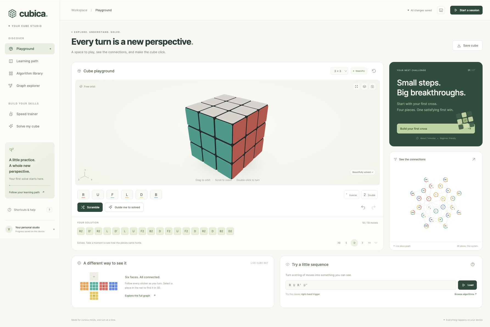

# Cubica — Cube Learning Studio

[](https://github.com/wieslawsoltes/cubica/actions/workflows/pages.yml)

**[Open Cubica](https://wieslawsoltes.github.io/cubica/)** · [Source](https://github.com/wieslawsoltes/cubica)

A browser cube studio for exploration, learning, graph study, and speed practice. The application is static, runs its model and solvers locally, and has no runtime CDN or framework dependency.



## What is included

| Area | Functionality |
| --- | --- |
| 3D playground | 2×2 through 7×7; orbit, wheel/pinch zoom, animated turns, picking, exploded/translucent views, undo/redo, reset and scrambles |
| Notation | Face, inverse and half turns; wide/lowercase moves; odd-cube slices; whole-cube rotations; repeated groups; commutators and conjugates |
| Learning path | 25 original lessons from cube anatomy and a complete beginner layer method through CFOP, Roux, ZZ, lookahead, finger tricks, blindfolded foundations, reduction and group structure |
| Algorithm library | 93 cases: all 57 OLL, all 21 PLL, and 15 foundational/F2L/pattern/commutator sequences; generated recognition diagrams, exact inverse setups, favorites, guided playback and manual drills |
| Graph explorer | Full physical cubie topology, cross target maps, actual permutation/orientation cycles, and a bounded state neighborhood; node and net selection is linked to 3D |
| Solver | History-independent legal 3×3 and 2×2 solving in a cancellable Worker; import from painted stickers, facelet strings or validated JSON snapshots |
| Cross planner | Exact shortest path for the four yellow cross edges, with animation and individual turn explanations |
| Speed practice | Space/touch timing, 15-second inspection, +2/DNF, per-size sessions, personal best, ao5/ao12, time charts and CSV export |
| Persistence | Local progress and cube state, JSON import/export, local favorites and drill results; static assets cached for offline reuse when service workers are available |

## Run and verify

Serve `dist/` over HTTP on localhost or HTTPS:

```sh
python3 -m http.server 8080 --directory dist
```

No package installation or build step is required. The package is an ES module project. The tests use the Node standard library:

```sh
node --test tests/*.test.mjs
```

The suite independently checks move conventions against the vendored established implementation, randomized history-free solving, legality invariants, cancellation and restart, exact cross-table coverage, graph rotations, the complete OLL/PLL catalogs, timing/average boundaries, and deployment beneath a GitHub Pages project path.

## GitHub Pages deployment

The complete application is served from `dist/` at **https://wieslawsoltes.github.io/cubica/**. The [Pages workflow](.github/workflows/pages.yml) runs the test suite on Node.js 24 and uploads the static application only after it passes. Pushes to `main` deploy automatically; pull requests run the same tests without publishing. The workflow can also be started manually from the Actions tab.

GitHub Actions is the Pages publishing source in **Settings → Pages → Build and deployment**. For a fork, select that source in the fork's settings and run the workflow. All application, module, worker and service-worker URLs resolve relative to their own installation path, so no base-path build configuration is required. Offline caches are isolated by the service-worker scope on a shared `github.io` origin.

The workflow pins GitHub's official actions to immutable commit SHAs, uses a read-only checkout without persisted credentials, and grants Pages deployment permissions only to its deployment job. No deployment secret, package installation or compilation step is needed.

## Architecture

`dist/modules/cube.js` is the authoritative geometric model. Cubie positions and sticker normals use exact signed coordinate permutations, including half-integer coordinates on even cubes. Animation never mutates the logical state. Snapshot histories are replayed before they are trusted. 3×3 physical imports validate counts, center frame, piece identities, handedness, corner-twist sum, edge-flip sum, and matching permutation parity.

`dist/modules/renderer.js` uses native WebGPU and WGSL. It instances bevelled cubie and rounded sticker meshes, with studio lighting, 4× MSAA and a soft contact shadow. The normal view uses three draw calls. Rendering is demand driven, and pixel density is bounded. Device loss and unavailable adapters switch to a clearly labeled Canvas 3D renderer driven by the same state and camera. `animateMove()` reports cancellation, so a canceled visual operation cannot silently commit a logical turn.

`dist/modules/solver.js` serializes worker requests, reports progress, supports cancellation, and verifies every proposed solution against an independent clone of the geometric model. `solver-worker.js` contains the search integration. The upstream MIT `cubejs` implementation is vendored under `dist/vendor/cubejs/`; its license and pinned provenance are retained there. The 2×2 solver embeds the corner problem into a legal 3×3 and verifies the resulting corner solution.

The cross solver uses the complete reduced state space of four selected edges: `12 × 11 × 10 × 9 × 2⁴ = 190,080` states. Breadth-first distances yield an optimal path in the face-turn metric, counting a half turn as one move. All six color databases were tested, each with diameter eight. The public API supports all six target colors; the studio's initial training view uses yellow D.

`dist/modules/graphs.js` derives all diagrams from current cubies. The 3×3 physical graph contains all 26 shell cubies and 48 face-adjacency links. The 3×3 graph's solved markers, cross progress, permutation cycles, flips and twists use the live color-center frame, so merely rotating a cube does not invent a new permutation. Larger physical graphs include every shell cubie and use original physical identities. Piece identifiers are shared with the renderer and unfolded net.

`dist/modules/curriculum.js` stores original teaching content and standard functional move sequences. Recognition previews are generated by applying each algorithm's inverse to a solved model. Tests prove that all 57 OLL orientations are distinct up to U alignment and preserve F2L; all 21 PLL cases preserve F2L and upper orientation. The app links to primary teaching references.

`dist/modules/practice.js` contains timing math. Single results truncate to centiseconds; averages round to the nearest centisecond. Penalties are applied before trimming. Averages of 5 and 12 drop one best and one worst result, allowing one DNF to be discarded but returning DNF with two. Raw timing measurements are retained for CSV export.

`dist/app.js` binds the modules to the interface. Manual input uses a bounded sequential queue, playback commits complete turns atomically, and assisted solves do not count as manual drill results. Large move sequences render only a window of timeline chips. Persistence failures leave the session usable in memory. No account or external solver service is required.

## Precise scope

- The general 3×3 two-phase solver returns a short valid solution; it does not promise a globally shortest full-cube solution. The separate cross planner is optimal in its declared metric.
- 4×4–7×7 guided solving is verified reversal of recorded studio moves. It is not an arbitrary-state reduction solver for imported larger cubes.
- The state-space graph is the exact 13-state, 12-transition local neighborhood reached by R, U and F to depth two. It is deliberately labeled as a sample, not the entire 3×3 group.
- Roux, ZZ, blindfolded solving, 2×2 and larger-cube reduction have teaching guides. Separate complete CMLL, CLL/EG, blindfold execution and big-cube parity algorithm catalogs are not included. Full OLL and PLL catalogs are included.
- Practice scrambles are random-move sequences rather than official competition random-state scrambles.
- Guided lesson cases are prepared demonstrations. The automatic solver explains individual turns; it is distinct from a dynamically generated human-method coaching solver.

## Browser verification

The integrated studio was tested through its browser UI: a fresh scramble solved and played to completion; forward/back steps maintained state; a prepared cross produced a two-turn optimal solution; algorithm filtering and diagrams worked; invalid sticker counts were rejected; timed sessions and inspection worked; JSON download and subsequent import restored the same 20-move scramble; queued keyboard input retained all four rapid turns; 7×7 rendering and turns worked; and a 390 × 844 viewport displayed usable mobile controls and navigation.

The available QA browser reported no WebGPU adapter, so these interactive checks exercised the Canvas 3D fallback. Native WebGPU code and shader setup are implemented, but GPU execution on physical hardware remains unverified in this environment. The responsive phone check used a constrained browser viewport, not a physical handset. Offline precaching is implemented; a disconnected-device session has not been exercised here.
