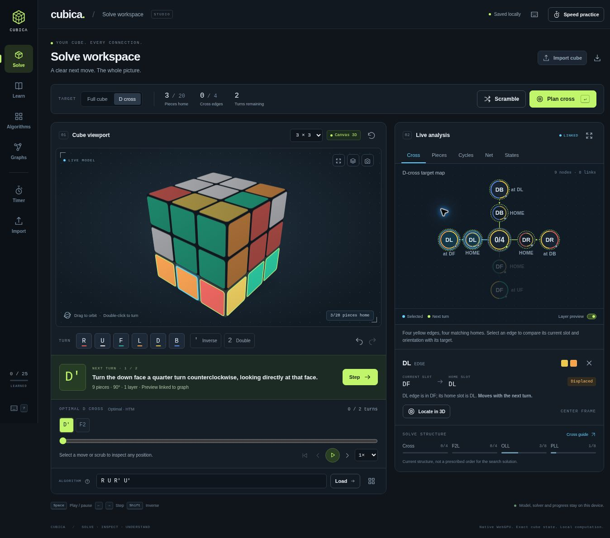

# Cubica — Cube Solving Studio

[](https://github.com/wieslawsoltes/cubica/actions/workflows/pages.yml)

**[Open Cubica](https://wieslawsoltes.github.io/cubica/)** · [Source](https://github.com/wieslawsoltes/cubica)

A browser workbench for solving, inspecting, and understanding the cube. The 3D viewport, next turn, solution timeline, linked diagrams, and selected-piece inspector share one workspace. A compact navigation rail opens learning, algorithms, graph study, speed practice, and cube import.

The application is static, runs its model and solvers locally, and has no runtime CDN or framework dependency.



## What is included

| Area | Functionality |
| --- | --- |
| Solve workspace | Dark workbench with the cube, inline planning, next-turn explanation, seekable timeline, and linked analysis visible together |
| 3D viewport | Native WebGPU; 2×2 through 7×7; orbit, wheel/pinch zoom, animated turns, picking, exploded/translucent views, camera focus on a selected piece, undo/redo, reset and scrambles |
| Move inspection | Exact next-turn layer preview, affected-piece counts, angle and direction; independent highlights for the selected piece and the pending turn |
| Notation | Face, inverse and half turns; wide/lowercase moves; odd-cube slices; whole-cube rotations; repeated groups; commutators and conjugates |
| Learning path | 25 original lessons from cube anatomy and a complete beginner layer method through CFOP, Roux, ZZ, lookahead, finger tricks, blindfolded foundations, reduction and group structure |
| Algorithm library | 93 cases: all 57 OLL, all 21 PLL, and 15 foundational/F2L/pattern/commutator sequences; generated recognition diagrams, exact inverse setups, favorites, guided playback and manual drills |
| Linked analysis | Cross targets, full physical topology, directed permutation/orientation cycles, unfolded net, and a bounded state neighborhood; selection follows the same physical piece in every view |
| Piece inspector | Current/home slot, sticker colors, placement and orientation, next-turn involvement, and a Locate in 3D action; selection emphasizes neighbors or the complete permutation cycle |
| Solver | History-independent legal 3×3 and 2×2 solving in a cancellable Worker; progress and cancellation stay inline; import from painted stickers, facelet strings or validated JSON snapshots |
| Cross planner | Exact shortest path for the four yellow D cross edges, with individual turn explanations and live target progress |
| Solve structure | Center-relative Cross/F2L/OLL/PLL measurements with cumulative completion checks; independent of the search solution's move order |
| Speed practice | Space/touch timing, 15-second inspection, +2/DNF, per-size sessions, personal best, ao5/ao12, time charts and CSV export |
| Persistence | Local cube state, learning progress, favorites, drill results, and analysis preferences; JSON import/export; static assets cached for offline reuse when service workers are available |

## Solve in one workspace

1. **Choose a position.** Scramble a cube, turn it manually, load an algorithm case, or import a saved state. The 3×3 color editor checks a painted cube before planning a solution.
2. **Choose the target.** Select **Full cube** or **D cross**, then **Find solution** or **Plan cross**. Search progress appears above the workspace, leaving the cube and diagrams visible. Cancel stops the worker request; turn controls are locked while it searches. Full-cube solving on 4×4–7×7 uses verified recorded-history reversal.
3. **Inspect the next turn.** The turn coach shows notation, direction, angle, layer count, and affected pieces. Layer preview uses a separate visual treatment from the selected piece. A face center can belong to the turning layer while remaining in place; the inspector distinguishes that case.
4. **Play, step, or seek.** Move buttons jump to the position after the chosen move. The timeline scrubber reconstructs the saved starting state plus the exact move prefix. Forward/backward steps and playback use that same model, so the cube, diagrams, inspector, and remaining-turn count agree.
5. **Follow a piece.** Select a 3D piece, graph node, cross target, or net sticker to inspect its current and home slots. **Locate in 3D** aims the camera at it. Switch among **Cross**, **Pieces**, **Cycles**, **Net**, and **States**, or expand **Graph lab** for more diagram space while retaining the cube and solving controls. On narrow screens, Graph lab scrolls directly to analysis and focuses its selected tab; returning to Solve restores the viewport at the top. In the States diagram, activating a node plays the path to that sampled state.

The solve-structure strip reports the current cube state. Its completion checks include prerequisites: OLL cannot be complete while F2L is broken, and PLL cannot be complete before OLL. The two-phase search does not follow a prescribed CFOP teaching sequence, so its turns may temporarily undo a displayed milestone. These measurements are not estimates of the remaining solution length.

### Keyboard and pointer controls

| Context | Control | Action |
| --- | --- | --- |
| Workspace | `R U F L D B` | Turn a face; hold Shift for its inverse or Alt for a half turn |
| Workspace | `x y z` | Rotate the whole cube; camera orbit leaves the logical state unchanged |
| Workspace | `M E S` | Turn the middle slices on an odd-layer cube |
| Workspace | Enter | Plan the selected solving target when focus is outside an interactive control |
| Playback | Space; ← / → | Play/pause; step backward/forward |
| History | Ctrl/⌘ Z; Ctrl/⌘ Shift Z | Undo; redo |
| Analysis tabs | ← / →; Home / End | Switch diagrams; select the first/last available diagram |
| Graph or net | Arrow keys; Enter or Space; Escape | Move focus between nodes/stickers; select; clear the piece selection |
| Viewport | Drag; wheel or pinch; double-click a face | Orbit; zoom; turn the face |
| Speed trainer | Hold and release Space; press again | Arm and start the timer; stop the attempt |
| Help | `?` | Open notation and shortcut help |

Text fields retain text-entry behavior. Graph and net navigation use a single tab stop, restore focus after redraws, and keep graph arrow-key navigation separate from playback stepping.

## Run and verify

Serve `dist/` over HTTP on localhost or HTTPS:

```sh
python3 -m http.server 8080 --directory dist
```

No package installation or build step is required. The package is an ES module project. The tests use the Node standard library:

```sh
node --test tests/*.test.mjs
```

The suite contains **51 tests**. It independently checks move conventions against the vendored established implementation, randomized history-free solving, legality invariants, cancellation and restart, exact cross-table coverage, the complete OLL/PLL catalogs, timing/average boundaries, and deployment beneath a GitHub Pages project path. Solve-insight tests cover all 24 whole-cube orientations, cumulative milestone prerequisites, placed-but-flipped pieces, and predicted move effects against actual 2×2–7×7 geometry. Graph tests cover physical neighbors, shared cross-target identity, independent pending-turn highlights, and complete directed-cycle focus.

## GitHub Pages deployment

The complete application is served from `dist/` at **https://wieslawsoltes.github.io/cubica/**. The [Pages workflow](.github/workflows/pages.yml) runs the test suite on Node.js 24 and uploads the static application only after it passes. Pushes to `main` deploy automatically; pull requests run the same tests without publishing. The workflow can also be started manually from the Actions tab.

GitHub Actions is the Pages publishing source in **Settings → Pages → Build and deployment**. For a fork, select that source in the fork's settings and run the workflow. All application, module, worker and service-worker URLs resolve relative to their own installation path, so no base-path build configuration is required. Offline caches are isolated by the service-worker scope on a shared `github.io` origin.

The workflow pins GitHub's official actions to immutable commit SHAs, uses a read-only checkout without persisted credentials, and grants Pages deployment permissions only to its deployment job. No deployment secret, package installation or compilation step is needed.

When releasing UI changes, bump the release query token (currently `20261104-workspace-2`) consistently in `dist/index.html`: the `app.js`, stylesheet and favicon URLs, plus all seven frontend module destinations in the import map. This gives the released frontend distinct browser-cache URLs when its entry page is loaded. The scoped service worker canonicalizes query URLs for offline cache reads and writes, so the existing precache remains usable. This release convention adds no installation or build step.

## Architecture

`dist/modules/cube.js` is the authoritative geometric model. Cubie positions and sticker normals use exact signed coordinate permutations, including half-integer coordinates on even cubes. Animation never mutates the logical state. Snapshot histories are replayed before they are trusted. 3×3 physical imports validate counts, center frame, piece identities, handedness, corner-twist sum, edge-flip sum, and matching permutation parity.

`dist/modules/renderer.js` uses native WebGPU and WGSL. It instances bevelled cubie and rounded sticker meshes, with studio lighting, 4× MSAA and a soft contact shadow. The normal view uses three draw calls. Rendering is demand driven, and pixel density is bounded. Light/dark appearance, selected-piece emphasis, and affected-layer preview are separate renderer state; `focusPiece()` targets the camera without changing the cube. Device loss and unavailable adapters switch to a clearly labeled Canvas 3D renderer driven by the same state and camera. `animateMove()` reports cancellation, so a canceled visual operation cannot silently commit a logical turn.

`dist/modules/solver.js` serializes worker requests, reports progress, supports cancellation, and verifies every proposed solution against an independent clone of the geometric model. `solver-worker.js` contains the search integration. The upstream MIT `cubejs` implementation is vendored under `dist/vendor/cubejs/`; its license and pinned provenance are retained there. The 2×2 solver embeds the corner problem into a legal 3×3 and verifies the resulting corner solution.

The cross solver uses the complete reduced state space of four selected edges: `12 × 11 × 10 × 9 × 2⁴ = 190,080` states. Breadth-first distances yield an optimal path in the face-turn metric, counting a half turn as one move. All six color databases were tested, each with diameter eight. The public API supports all six target colors; the workspace's cross target is yellow D.

`dist/modules/graphs.js` derives all diagrams from current cubies. The 3×3 physical graph contains all 26 shell cubies and 48 face-adjacency links. The 3×3 graph's solved markers, cross progress, permutation cycles, flips and twists use the live color-center frame, so merely rotating a cube does not invent a new permutation. Larger physical graphs include every shell cubie and use original physical identities. `graphFocus()` derives the selected node, physical neighbors, directed-cycle component, and a separate pending-turn overlay. Piece identifiers are shared with the renderer and unfolded net. Both SVG views support spatial keyboard focus and selection, including preserving focus when the diagrams redraw.

`dist/modules/insights.js` provides pure `analyzeCube()`, `inspectPiece()`, and `analyzeMove()` functions. They derive metrics and explanations from the exact model in linear time without cloning move histories or constructing graph layouts. The 3×3 measurements normalize into the live color-center frame. Other cube sizes explicitly use original physical reference identities and do not claim CFOP milestone support. Move inspection separates every layer-selected ID from the subset whose position or sticker directions actually change.

`dist/modules/curriculum.js` stores original teaching content and standard functional move sequences. Recognition previews are generated by applying each algorithm's inverse to a solved model. Tests prove that all 57 OLL orientations are distinct up to U alignment and preserve F2L; all 21 PLL cases preserve F2L and upper orientation. The app links to primary teaching references.

`dist/modules/practice.js` contains timing math. Single results truncate to centiseconds; averages round to the nearest centisecond. Penalties are applied before trimming. Averages of 5 and 12 drop one best and one worst result, allowing one DNF to be discarded but returning DNF with two. Raw timing measurements are retained for CSV export.

`dist/app.js` coordinates the shared solve/graph workspace. Manual input uses a bounded sequential queue, playback commits complete turns atomically, and assisted solves do not count as manual drill results. Seeking reconstructs a sequence from its saved base and exact prefix rather than incrementally approximating a target position. Diagram redraw keys include the model revision, graph mode, selected identity, and pending-turn IDs. Large move sequences render only a window of timeline chips. Inline searches are cancellable and verify that their input state is still current before loading a result. Persistence failures leave the session usable in memory. No account or external solver service is required.

## Precise scope

- The general 3×3 two-phase solver returns a short valid solution; it does not promise a globally shortest full-cube solution. The separate cross planner is optimal in its declared metric.
- 4×4–7×7 guided solving is verified reversal of recorded studio moves. It is not an arbitrary-state reduction solver for imported larger cubes.
- The state-space graph is the exact 13-state, 12-transition local neighborhood reached by R, U and F to depth two. It is deliberately labeled as a sample, not the entire 3×3 group.
- Roux, ZZ, blindfolded solving, 2×2 and larger-cube reduction have teaching guides. Separate complete CMLL, CLL/EG, blindfold execution and big-cube parity algorithm catalogs are not included. Full OLL and PLL catalogs are included.
- Practice scrambles are random-move sequences rather than official competition random-state scrambles.
- Guided lesson cases are prepared demonstrations. The automatic solver explains individual turns; it is distinct from a dynamically generated human-method coaching solver.
- Cross/F2L/OLL/PLL indicators describe the current 3×3 structure. They do not prescribe or label stages within a generated two-phase solution. On larger cubes, reference-slot counts distinguish individual physical pieces even when same-color pieces are visually interchangeable.

## Browser verification

The deployed redesign was checked through its browser UI. A prepared cross planned in two moves, progressed from 0/4 to 4/4, and stepped backward to the prior position. A full-cube solution played to completion with 20/20 movable pieces home and all four structure milestones complete. Timeline selection and the range scrubber reconstructed earlier positions. Graph keyboard selection preserved playback position; net stickers, piece nodes, cross targets, and the inspector followed the same physical identity. The state-neighborhood graph applied its selected move, and Graph lab retained the cube and controls. Algorithm filtering and case loading, lesson dialogs, and timer recording were also exercised. Size-aware controls correctly disabled D-cross planning on 7×7 and displayed all 218 shell cubies; a 2×2 net exposed 24 stickers.

The responsive layout was checked in 390 × 844 and 820 × 1024 embedded browser viewports, including mobile navigation, direct Graph lab access, return-to-Solve focus, and cross-graph readability. Neither layout had horizontal document overflow. These are constrained browser viewports, not physical devices.

This redesign verification used the clearly labeled Canvas 3D fallback because the QA browser had no WebGPU adapter. The original application had previously been verified in Chrome with native WebGPU rendering, animated turns, and a completed solve; the redesign's new native GPU visual effects have not been rechecked in an adapter-capable browser. The 51 automated tests cover model, solver, insight and graph semantics, timing, and scoped offline assets; they do not establish GPU visual correctness. A disconnected-device session has not been exercised here.
